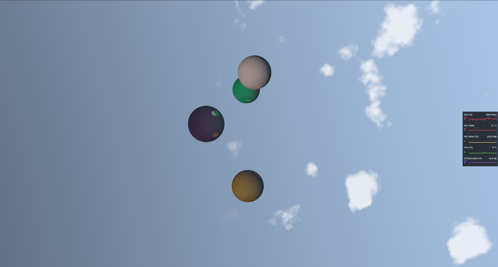

# 3dRenderer

A real-time GPU ray tracer written in Rust with WGSL shaders, built directly on `wgpu` and `winit` with no 3D framework. It runs as a native desktop app and in the browser through WebGPU/WASM.



### Working demo

<video src="https://github.com/user-attachments/assets/1582f30f-6242-4a90-b755-49836891770a" controls style="max-width: 100%;" muted autoplay loop>
</video>

## Features

- **Ray-traced spheres** with three material types, chosen by each sphere's `material` value: diffuse, reflective (blended by a specular ratio), and refractive (glass, using the sphere's `refractivity`).
- **Triangle mesh rendering.** STL meshes are loaded, deduplicated and rendered by ray tracing against a BVH. A sample `monkey.stl` is embedded in the binary.
- **BVH acceleration structure** built on the CPU (`src/utils/bvh.rs`), uploaded to the GPU and traversed in the fragment shader, including any-hit queries for shadow rays.
- **Lighting and shadows** from a variable number of point lights, with shadow rays and up to 3 ray bounces.
- **Procedural sky and clouds** generated in the shader with fBm, Worley noise and domain warping, with a cheaper sky sampler for secondary bounces.
- **Orbit/pan/fly camera** with mouse and keyboard controls, plus an FPS counter.
- **Native and web builds** from one codebase. The crate builds as both a binary and a `cdylib` for `wasm32`.

## Why I built it

I wanted to understand modern GPU programming from the layer below a rendering framework. Most tutorials start with a framework and never leave it, which hides the parts I wanted to learn: command buffers, bind groups, uniform and storage buffer layout, and how a draw call is assembled. The scene setup, camera, BVH and ray tracing are all written directly against the `wgpu` API.

## Requirements

- A recent Rust toolchain ([rustup.rs](https://rustup.rs)).
- A GPU and driver supported by `wgpu` (Vulkan, Metal or DX12 natively; a WebGPU-capable browser for the web build).

For the web build you also need:

- The wasm target: `rustup target add wasm32-unknown-unknown`
- `wasm-bindgen-cli`: `cargo install wasm-bindgen-cli`
- Node.js, for the small dev server in `serve.js`

## Running it

### Native

```bash
git clone https://github.com/sahuishan01/3dRenderer.git
cd 3dRenderer
cargo run --release
```

For iterative development:

```bash
cargo watch -c -w src -x run
```

### Web (WebGPU/WASM)

`build.ps1` compiles the library to `wasm32-unknown-unknown` and runs `wasm-bindgen` to produce `pkg/`:

```powershell
.\build.ps1          # release build
.\build.ps1 -Debug   # debug build
.\build.ps1 -Serve   # build, then start the dev server
```

`build.ps1` looks for `cargo` and `wasm-bindgen` in `%USERPROFILE%\.cargo\bin`. If you already built `pkg/`, start the server with `node serve.js` and open <http://localhost:8082>. The server sends the cross-origin isolation headers (`COOP`/`COEP`) the page needs, so serve the page through it rather than opening `index.html` directly.

## Controls

| Input | Action |
| --- | --- |
| Left mouse drag | Orbit around the focus point |
| Right mouse drag | Pan |
| Mouse wheel | Zoom toward / away from the focus point |
| `W` `A` `S` `D` | Move forward, left, backward, right |
| `Z` / `X` | Move up / down |
| `Ctrl` + movement keys | Orbit instead of translating |
| `Q` or `Esc` | Quit (native build) |

## Project layout

```
src/
├── main.rs            native entry point (winit event loop)
├── lib.rs             wasm entry point (wasm-bindgen)
├── application/       window/event handling (app.rs) and GPU state setup (state.rs)
├── rendering/         camera, lights and spheres, with their GPU buffers
├── shaders/main.wgsl  ray tracing, BVH traversal, materials, sky
└── utils/             STL mesh loading (mesh.rs), BVH build/upload (bvh.rs), vector math
assets/                sample image, window icon, monkey.stl
index.html, serve.js   web front end and dev server
build.ps1              WASM build script
```

## What's next

I'm treating this as a base to explore specific directions rather than a general-purpose engine. Candidate extensions:

- Deferred shading in WGSL
- A point cloud viewer that handles large datasets by streaming to the GPU
- A proper scene graph and material system

If you want to follow along, I write about the work at [profile.algosculptor.com/writings](https://profile.algosculptor.com/writings).

## License

MIT
